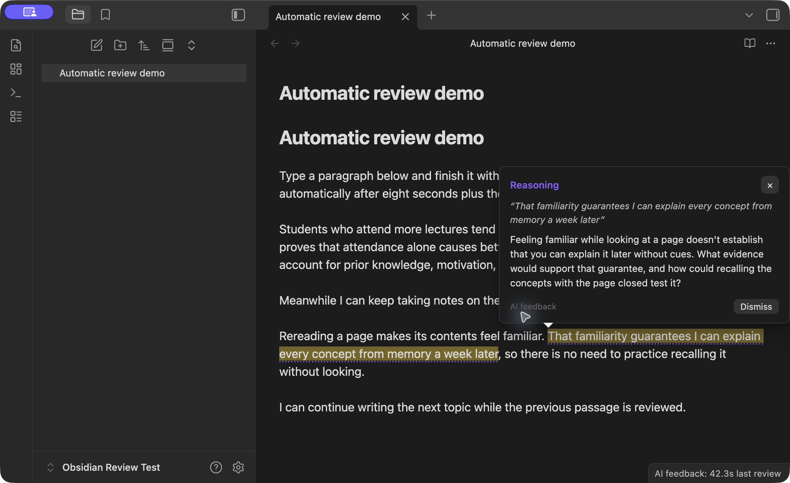

# Automatic Paragraph Review

Automatic Paragraph Review for desktop Obsidian.

Automatic study feedback inside desktop Obsidian, using your existing local Codex sign-in. Write normally. Relevant passages receive a subtle dotted underline. Hover, click the underline, or move your text cursor into it to read the feedback. No recurring prompt or chat panel is required.

The default focus is **understanding, reasoning, and possible factual gaps**. Feedback may identify an unsupported inference, ask a useful study question, or flag something to verify. It preserves shorthand and your voice. Factual concerns are not represented as sourced fact checks.

**Release: 1.0.1.** Available in the [Obsidian Community directory](https://community.obsidian.md/plugins/automatic-paragraph-review). Select **Add to Obsidian** on the listing to install it. The [GitHub release](https://github.com/williambooth0803-ui/Codex-Writing-in-Obsidian/releases/latest) also includes a manual-install ZIP.



## What is included

- Hover popovers with individual dismissal and keyboard access.
- Automatic review of new or changed prose and list items while you continue writing.
- Review of the current passage after its own idle period, without requiring a blank line.
- Up to three ready passages batched into one request; one request at a time.
- Saved feedback and dismissal state across plugin reloads.
- Rejection of feedback for passages that changed during the request.
- Note rename/deletion handling and folder exclusions.
- Configurable timing, batching, focus, optional standing preferences, and note restriction.
- Pause/resume from the status bar, settings, or command palette.
- Reported token totals and timing, plus timeouts and bounded retries for connection failures.
- No AI-generated text is inserted into your Markdown.

## Defaults

| Setting | Default |
| --- | --- |
| Completed passage eligibility | 8 seconds |
| Passage you are still writing | 30 seconds without changes to that passage |
| Minimum between request starts | 30 seconds |
| Passages per request | Up to 3 from the same note |
| Feedback per passage | Up to 2 useful comments, including zero when appropriate |
| Eligible passage length | 40–5,000 characters |
| Context | Up to 8,000 preceding characters of eligible same-note prose |
| Excluded folders | Templates, Attachments |

The timing is tied to individual passages. You do **not** have to stop writing the rest of the note. The local watcher does not use AI allowance. AI requests use your Codex account allowance. The default request interval caps starts at two per minute; idle, unchanged notes do not generate new reviews.

If several passages are queued, their total wait includes the request interval and previous work. The rate limit can be adjusted in settings. Reported token counts are not a conversion to a subscription percentage or a dollar charge.

## Try it

Install the plugin using the instructions below. Write a paragraph or list item, finish it with a blank line, and continue taking notes. A useful comment appears as a dotted underline; a final unfinished passage is reviewed after its idle period. Opening an existing note does not automatically review all its text.

Hover over an underline, click it, or move the text cursor into it to read feedback. Escape closes a keyboard-opened popover. The command **Automatic Paragraph Review: Show AI feedback at cursor** is also available. Dismiss removes an individual comment and saves that choice until the passage changes. **Dismiss feedback in current note** removes that note's visible comments.

## Installation and one-time setup

Install from the [Community listing](https://community.obsidian.md/plugins/automatic-paragraph-review) using **Add to Obsidian**, then install and enable the plugin in Obsidian. If you use this method, skip manual-copy steps 2 and 3 below. Codex installation and one-time connection setup are still required.

1. Install the [official Codex CLI](https://developers.openai.com/codex/cli/) and sign in with `codex login`. The plugin does not install Codex for you.
2. Download the manual-install ZIP from the [latest GitHub release](https://github.com/williambooth0803-ui/Codex-Writing-in-Obsidian/releases/latest) and extract its `automatic-paragraph-review` folder into `<vault>/.obsidian/plugins/`. Alternatively, create that folder and copy the release assets **main.js**, **manifest.json**, and **styles.css** into it. These are the only three runtime files.
3. Enable **Automatic Paragraph Review** in Obsidian's Community plugins settings.
4. Open the plugin's settings. Automatic reviews start disabled. Codex detection checks executable support and sign-in. If needed, enter the full executable path and select **Check connection**.
5. Set any note restriction or excluded folders, then select **Connect and enable**. This is a one-time opt-in to sending eligible text to Codex, not a prompt for each review.
6. Write normally. Click the status bar to pause or resume.

Feedback is available in editing / Live Preview mode. Requires **desktop Obsidian 1.13.7 or later**. Live-tested on macOS with Obsidian 1.13.7 and Codex CLI 0.163.0. Linux automated tests cover the engine and editor integration; other desktop operating systems have not been live-tested. Windows users may need a native `codex.exe` path. Mobile and Reading view are not supported.

If setup reports signed out, run `codex login` in your terminal and check again. If it reports missing options, update the CLI from its official installation instructions. The plugin requires support for `exec --output-schema`, `--ignore-user-config`, and `--ephemeral`. A subscription or other account access that supports Codex is required; service limits apply. The plugin does not require you to configure a separate API key.

## Data and operation

Each review sends selected passage text and nearby preceding prose from the same note to Codex. Frontmatter, fenced code, hidden comments, and quoted/table blocks are excluded from the extracted review context. Eligible changes are reviewed once; opening existing text is a baseline rather than an automatic whole-note upload.

Local feedback, source passage text, dismissals, settings, and aggregate usage metrics are stored in the vault's `.obsidian/plugins/automatic-paragraph-review/data.json`. They may travel with any service you use to sync plugin data. The plugin does not store an API key or copy your Codex credentials. Codex's existing authentication, account limits, and data handling apply.

The plugin launches the installed Codex executable outside the vault and writes a schema-only temporary file in the operating system temporary directory, removing it after each completed or failed review. Note text is passed through the process input, not a temporary note file. The CLI uses its own authentication and runtime storage outside the vault (normally `~/.codex`); CLI-managed storage and network activity follow Codex settings and service behavior. The plugin adds no telemetry or direct network client.

Requests use an ephemeral `codex exec` process, the CLI's default model and low reasoning, without user configuration. Shell execution, unified execution, connected apps, and web search are disabled for the review process; the sandbox is read-only. This version reviews the supplied text rather than researching sources or browsing your other notes. Timeout: 150 seconds. Connection failures retry up to twice with increasing cooldown. Pause cancels the current process and clears pending work.

Stored history is bounded to 300 passage results and 4,000 reviewed passage identifiers. Very short fragments and ambiguous identical passages are skipped. Large prose blocks above the configured maximum are skipped. Persistent results are tied to the exact source passage; editing it removes outdated feedback and makes the changed passage eligible for a new review.

## Development

Runtime files are already built. Source and tests are included for inspection:

- `main-source.js`: Obsidian interface, hover annotations, preferences, persistence.
- `review-core.js`: Markdown extraction, review queue, Codex client, validation.
- `build.js`: Bundles the core into `main.js`, avoiding stale module caches on plugin reload.
- `review-core.test.js`: Behavioral checks for the review engine.
- `tests/editor-integration.test.js`: Tests using real CodeMirror in a test DOM.
- `benchmark.js`: Makes one real Codex request containing three synthetic passages.

For development, use Node.js 24.15 or later and pnpm 11.25.0:

```sh
pnpm install --frozen-lockfile --ignore-scripts
pnpm run build
pnpm test
pnpm run release
# Optional: makes one real AI request
pnpm run benchmark
```

The benchmark consumes Codex allowance and overwrites `benchmark-results.json`. Build and unit tests do not call AI. See [verification.md](verification.md) for observed validation and timing limits.

## Releases and support

Source is licensed under [MIT](LICENSE), copyright 2026 williambooth0803-ui. Report reproducible issues in [GitHub Issues](https://github.com/williambooth0803-ui/Codex-Writing-in-Obsidian/issues), with plugin, Obsidian, operating system, and Codex versions. Remove personal note content and credentials from reports.

Pushing a new manifest/package version to `main` runs the checks and publishes a matching GitHub release only when they pass. Existing releases are left unchanged. See [PUBLISHING.md](PUBLISHING.md) for the directory submission procedure.
